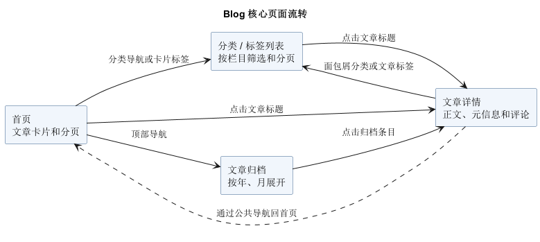
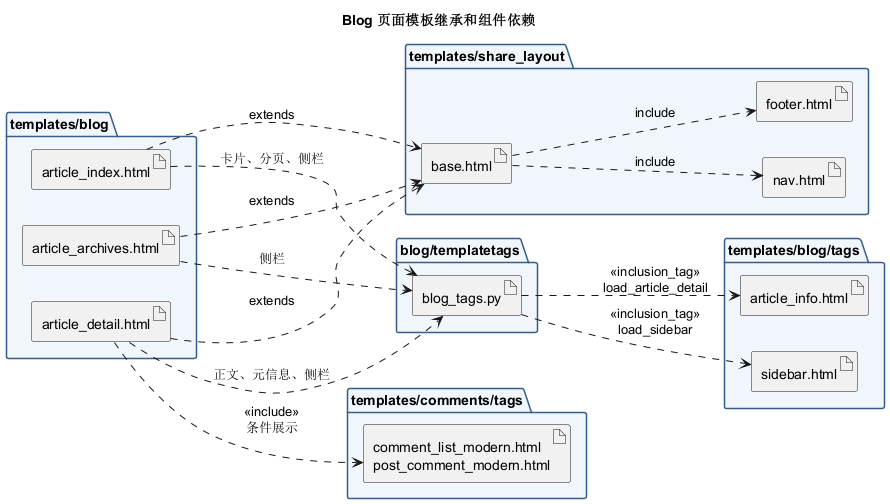

# Blog 核心页面与模板

第 4 周界面分析，覆盖首页、文章详情、归档和从这些页面可以到达的分类、标签列表。

| 页面 | 用户操作与流转 | 代码入口 |
| --- | --- | --- |
| 首页 | 从公共导航打开归档或分类，从文章卡片打开详情或标签列表。列表较长时使用分页。 | [首页模板](../src/DjangoBlog-master/templates/blog/article_index.html#L36-L55) · [导航](../src/DjangoBlog-master/templates/share_layout/nav.html) |
| 文章详情 | 显示正文和元信息。读者可以沿分类面包屑或标签回到文章列表。文章与站点都开启评论时显示评论区域。 | [详情模板](../src/DjangoBlog-master/templates/blog/article_detail.html) |
| 归档 | 在公共导航进入归档，按发布时间的年和月查看条目，再从标题打开详情。 | [归档模板](../src/DjangoBlog-master/templates/blog/article_archives.html#L29-L65) |

三张页面通过 `extends` 复用 `share_layout/base.html` 的公共布局。母模板通过 `include` 插入导航和页脚。首页调用 `load_article_detail` 生成文章卡片，各页面通过 `load_sidebar` 加载侧栏。卡片和侧栏由注册的 `inclusion_tag` 选择对应组件。详情页则以 `include` 插入评论列表和表单。 [母模板](../src/DjangoBlog-master/templates/share_layout/base.html#L173-L190) · [模板标签](../src/DjangoBlog-master/blog/templatetags/blog_tags.py)

[两张图的 PlantUML 源文件](blog_界面流转与模板包图.puml)
