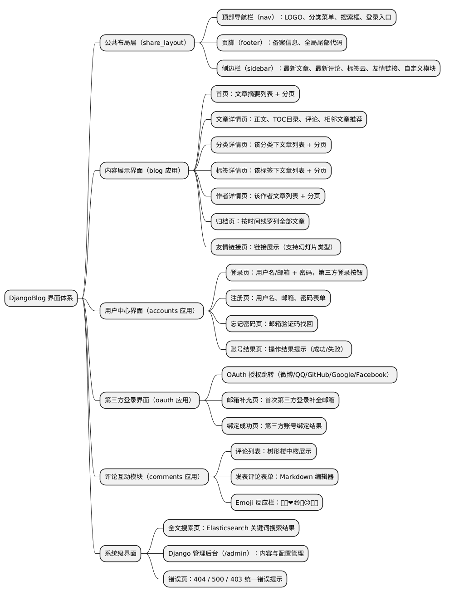
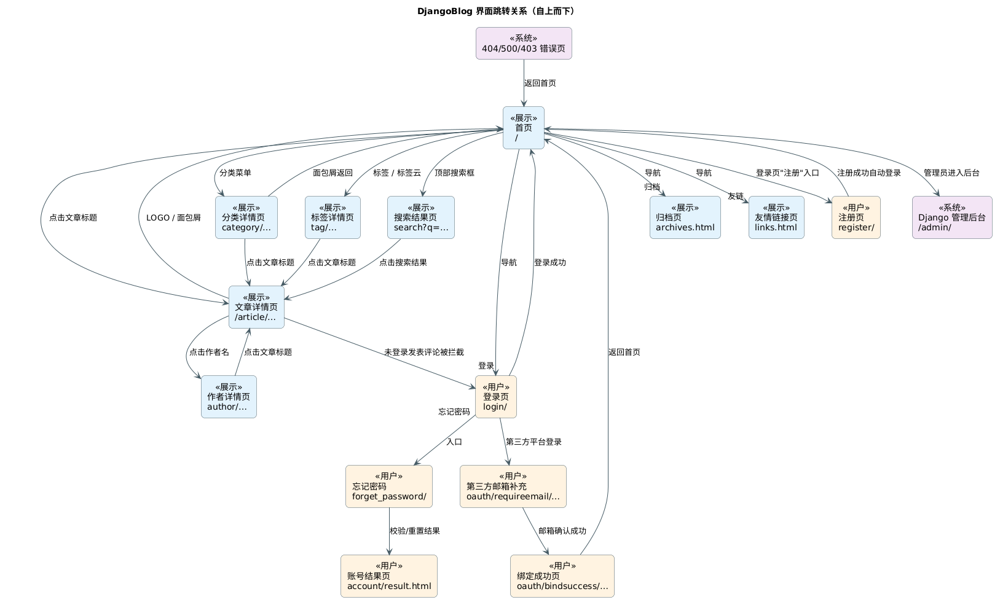
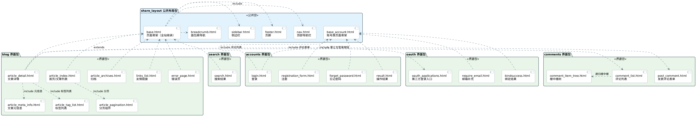
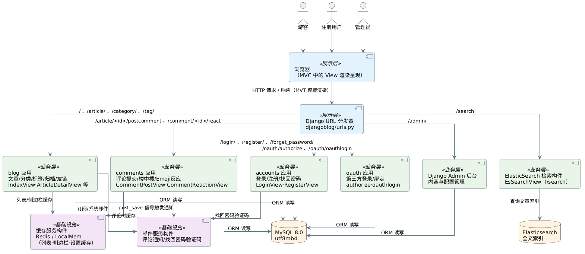

# DjangoBlog 界面设计说明书

> **软件工程大作业 - 第4周实践任务**
>
> **项目名称**：DjangoBlog 博客系统
>
> **版本**：v1.0
>
> **日期**：2026-10-18
>
> **配套文档**：《数据模型设计说明书》（见同目录）

---

## 1. 引言

### 1.1 编写目的

本文档依据第 4 周实践任务要求编写，对 DjangoBlog 系统的**用户界面设计**进行分析与说明：

1. 以**思维导图**的形式说明系统的界面组成结构；
2. 以**跳转关系图**的形式说明系统的界面和界面跳转关系；
3. 分析界面与界面内模块的功能与关系，并以**包图**说明 UI 的组成结构与模块间关系；
4. 给出系统**构件图**，说明界面层与业务层、数据层构件的关系。

### 1.2 适用范围与读者对象

适用于本小组全体成员，作为后续界面开发、测试与验收的依据；同时供教师检查第 4 周实践成果。

### 1.3 术语与缩写

| 术语 | 说明 |
|------|------|
| MVT | Django 的 Model-View-Template 架构模式，本文档关注其中的 Template（界面）层 |
| UI | User Interface，用户界面 |
| TOC | Table of Contents，文章目录 |
| 楼中楼 | 评论的嵌套回复结构（树形） |
| OAuth | 开放授权协议，用于第三方登录 |

---

## 2. 界面设计总则

### 2.1 设计原则

1. **模板继承复用**：全站页面继承 `base.html` 骨架，账号类页面继承 `base_account.html`，保证风格统一、改动集中；
2. **布局三段式**：内容页采用"顶部导航栏 + 主内容区 + 右侧边栏 + 页脚"的经典博客布局；
3. **响应式设计**：基于 Bootstrap 构建，桌面端与移动端（nav_node_mobile）自适应；
4. **主题可配置**：站点配色方案由 `BlogSettings.color_scheme` 控制（purple/blue/green/orange/pink/red/indigo/teal 共 8 套）；
5. **模块化组件**：分页、面包屑、文章元信息、评论树等均以 templatetag 组件形式复用。

### 2.2 整体布局结构

```
┌──────────────────────────────────────────────────┐
│ 顶部导航栏 nav：LOGO｜分类菜单｜归档/友链｜搜索框｜登录/用户中心 │
├───────────────────────────────────────┬──────────┤
│                                       │  侧边栏   │
│           主内容区                      │ sidebar  │
│  （文章列表 / 文章详情 / 表单页等）         │ ·最新文章 │
│                                       │ ·最新评论 │
│                                       │ ·标签云   │
│                                       │ ·友情链接 │
├───────────────────────────────────────┴──────────┤
│ 页脚 footer：备案信息、全局尾部代码、版权              │
└──────────────────────────────────────────────────┘
```

---

## 3. 界面结构总览（思维导图）



*图 3-1 系统界面结构思维导图（源文件：[UI_MindMap.puml](UI_MindMap.puml)）*

### 3.1 界面清单

| 编号 | 界面名称 | URL 路由 | 模板文件 | 主要功能 | 所属模块 |
|------|----------|----------|----------|----------|----------|
| U01 | 首页 | `/`、`/page/<n>/` | blog/article_index.html | 文章摘要列表、分页 | blog |
| U02 | 文章详情页 | `/article/<y>/<m>/<d>/<id>.html` | blog/article_detail.html | 正文渲染、TOC、评论、Emoji 反应、相邻文章推荐 | blog + comments |
| U03 | 分类详情页 | `/category/<slug>.html`（含分页） | blog/article_index.html | 该分类文章列表 | blog |
| U04 | 标签详情页 | `/tag/<slug>.html`（含分页） | blog/article_index.html | 该标签文章列表 | blog |
| U05 | 作者详情页 | `/author/<name>.html`（含分页） | blog/article_index.html | 该作者文章列表 | blog |
| U06 | 归档页 | `/archives.html` | blog/article_archives.html | 按时间线罗列全部文章 | blog |
| U07 | 友情链接页 | `/links.html` | blog/links_list.html | 友链展示 | blog |
| U08 | 搜索结果页 | `/search?q=…` | search/search.html | Elasticsearch 全文搜索 | blog/ES |
| U09 | 登录页 | `/login/` | account/login.html | 用户名/邮箱登录、第三方登录入口 | accounts + oauth |
| U10 | 注册页 | `/register/` | account/registration_form.html | 注册表单 | accounts |
| U11 | 忘记密码页 | `/forget_password/` | account/forget_password.html | 邮箱验证码找回 | accounts |
| U12 | 账号结果页 | `/account/result.html` | account/result.html | 操作结果提示 | accounts |
| U13 | 第三方邮箱补充页 | `/oauth/requireemail/<id>.html` | oauth/require_email.html | 首次第三方登录补全邮箱 | oauth |
| U14 | 绑定成功页 | `/oauth/bindsuccess/<id>.html` | oauth/bindsuccess.html | 第三方绑定结果 | oauth |
| U15 | 管理后台 | `/admin/` | Django admin | 内容/评论/配置管理 | admin |
| U16 | 统一错误页 | 404/500/403 | blog/error_page.html | 错误提示、返回首页 | blog |

> 评论模块（评论列表、楼中楼、发表表单、Emoji 反应栏）以组件形式嵌入 U02 文章详情页，见 `comments/tags/*.html`。

---

## 4. 界面跳转关系



*图 4-1 系统界面跳转关系图（源文件：[UI_NavigationDiagram.puml](UI_NavigationDiagram.puml)）*

### 4.1 跳转主线说明

| 主线 | 跳转路径 | 触发方式 |
|------|----------|----------|
| 内容浏览主线 | 首页 → 文章详情页 | 点击文章标题 |
| | 首页 → 分类/标签/作者详情页 → 文章详情页 | 点击导航分类菜单 / 文章标签 / 作者名 |
| | 首页 → 归档页 / 友情链接页 | 顶部导航菜单 |
| | 首页 → 搜索结果页 → 文章详情页 | 顶部搜索框提交 |
| | 详情页 → 首页/上级分类 | LOGO、面包屑导航 |
| 用户中心主线 | 首页 → 登录页 → 首页 | 导航"登录"；登录成功 `success_url=/` |
| | 登录页 ↔ 注册页 | "注册"入口；注册成功自动登录回首页 |
| | 登录页 → 忘记密码页 → 账号结果页 | "忘记密码"入口；验证码校验 |
| 第三方登录主线 | 登录页 → OAuth 授权 → （邮箱补充页）→ 绑定成功页 → 首页 | 点击第三方平台按钮 |
| 评论互动主线 | 文章详情页（未登录）→ 登录页 | 未登录发表评论被拦截 |
| | 文章详情页内：发表评论 / 楼中楼回复 / Emoji 反应 | 表单提交（PRG 防重复）与 Ajax toggle |
| 系统管理主线 | 首页 → Django 管理后台 | 管理员访问 `/admin/` |
| 异常路径 | 任意页 → 统一错误页 → 返回首页 | 404/500/403 |

---

## 5. 界面与模块关系（包图）



*图 5-1 UI 组成结构包图（源文件：[UI_PackageDiagram.puml](UI_PackageDiagram.puml)）*

### 5.1 模块关系说明

| 关系 | 说明 |
|------|------|
| 界面包 → share_layout | blog/search 界面包页面 `extends base.html`；accounts/oauth 界面包页面 `extends base_account.html` |
| share_layout 内部 | `base.html` 通过 include 组合 nav（导航）、sidebar（侧边栏）、footer（页脚） |
| blog 包内部 | 详情页 include 元信息、标签列表、分页等组件；首页 include 分页组件 |
| blog ↔ comments | `article_detail.html` include 评论列表 `comment_list.html`（递归渲染楼中楼 `comment_item_tree.html`）与评论表单 `post_comment.html` |
| accounts ↔ oauth | `login.html` include `oauth_applications.html`（第三方登录按钮区） |

---

## 6. 系统构件图



*图 6-1 系统构件图（源文件：[UI_ComponentDiagram.puml](UI_ComponentDiagram.puml)）*

界面层（模板）由 Django URL 分发器统一调度 5 个业务应用构件（blog、comments、accounts、oauth、检索），业务构件通过 ORM 访问 MySQL，通过缓存构件加速高频查询，评论通知与找回密码由邮件服务构件异步支撑，全文搜索由 Elasticsearch 构件承担。

---

## 7. 核心界面交互细节

### 7.1 首页（U01）

- **布局**：主内容区展示文章摘要（摘要长度由 `BlogSettings.article_sub_length` 控制，默认 300 字），底部为分页条；
- **数据**：仅展示 `status=p`（已发布）、`type=a`（普通文章），按 `pub_time` 倒序，走组合索引 `idx_type_status_pub`；
- **入口**：侧边栏"最新文章/最新评论/标签云"、导航分类菜单均可跳转至对应列表或详情。

### 7.2 文章详情页（U02）

- **布局**：面包屑 → 文章标题与元信息（作者/发布时间/浏览量/标签）→ Markdown 正文（可选 TOC 目录）→ 相邻文章推荐 → 评论区；
- **评论互动**：
  - 评论列表：树形楼中楼（`parent_comment` 自关联），默认分页（每页数量由 `BlogSettings.article_comment_count` 控制）；
  - 发表评论：Markdown 编辑器，未登录用户被引导至登录页；新评论是否需审核由 `comment_need_review` 控制；
  - Emoji 反应栏：👍👎❤😄🎉😕🚀👀 八种，Ajax toggle 切换，同一用户对同一评论同一 Emoji 幂等（唯一约束）；
  - 提交采用 **PRG 模式**（Post-Redirect-Get）防止刷新重复提交；
- **计数**：浏览量 +1（独立更新，不污染缓存）。

### 7.3 登录/注册/找回密码（U09/U10/U11）

- 采用独立的简洁骨架 `base_account.html`；
- 登录支持**用户名或邮箱**双模式；登录/注册成功后统一跳转首页；
- 找回密码通过邮箱验证码完成，验证码由邮件服务构件发送；
- 登录页下方展示已启用的第三方登录按钮（来自 `OAuthConfig.is_enable`）。

### 7.4 搜索结果页（U08）

- 关键词经 Elasticsearch 检索构件查询文章全文索引，返回结果列表并高亮关键词；
- 结果项点击进入对应文章详情页。

---

## 8. 界面截图（待本地部署后补充）

按第 1 周任务要求，小组已在本地搭建并调试运行 DjangoBlog。请各成员运行 `python manage.py runserver` 后按以下清单截图，保存为 PNG 放入 `doc/screenshots/` 目录并命名（编码_界面名.png），随后嵌入本节对应位置：

| 编号 | 截图内容 | 截图文件名（约定） | 负责人 |
|------|----------|---------------------|--------|
| U01 | 首页（含侧边栏与分页） | U01_index.png | 待分配 |
| U02 | 文章详情页（含评论区与 Emoji 反应） | U02_article_detail.png | 待分配 |
| U06 | 归档页 | U06_archives.png | 待分配 |
| U08 | 搜索结果页 | U08_search.png | 待分配 |
| U09 | 登录页（含第三方登录按钮） | U09_login.png | 待分配 |
| U10 | 注册页 | U10_register.png | 待分配 |
| U15 | 管理后台 | U15_admin.png | 待分配 |

> 截图完成后请将本节表格中的"待分配"更新为实际负责人，并在每个文件名后附上截图插入本文档。

---

## 9. 附录：界面层文件与路由对照

| App | 路由定义 | 模板目录 |
|-----|----------|----------|
| blog | [../src/DjangoBlog-master/blog/urls.py](../src/DjangoBlog-master/blog/urls.py) | templates/blog/ |
| comments | [../src/DjangoBlog-master/comments/urls.py](../src/DjangoBlog-master/comments/urls.py) | templates/comments/tags/ |
| accounts | [../src/DjangoBlog-master/accounts/urls.py](../src/DjangoBlog-master/accounts/urls.py) | templates/account/ |
| oauth | [../src/DjangoBlog-master/oauth/urls.py](../src/DjangoBlog-master/oauth/urls.py) | templates/oauth/ |
| 总路由 | [../src/DjangoBlog-master/djangoblog/urls.py](../src/DjangoBlog-master/djangoblog/urls.py) | templates/share_layout/、templates/search/ |
