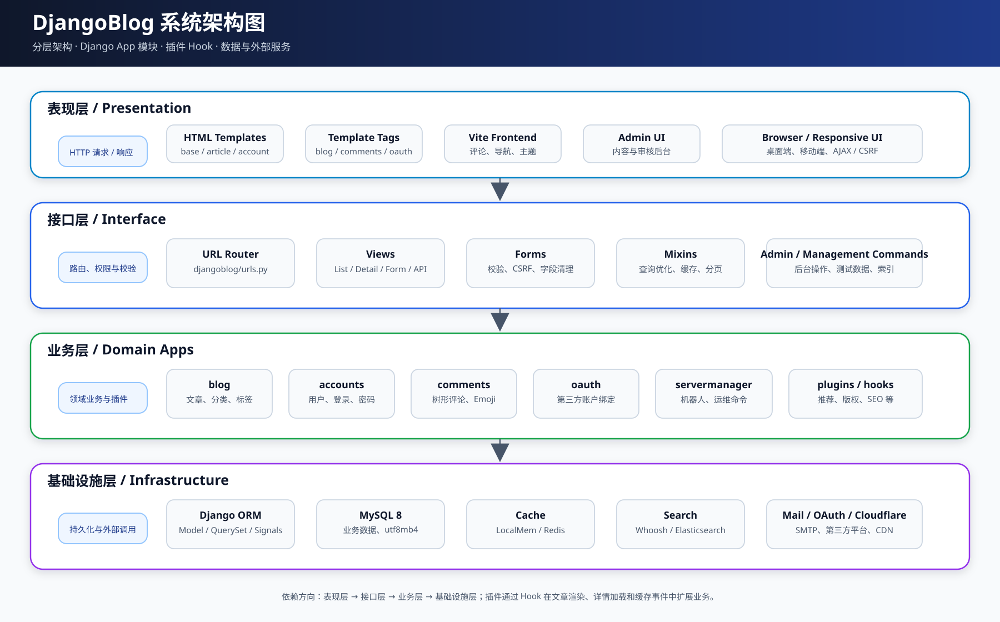
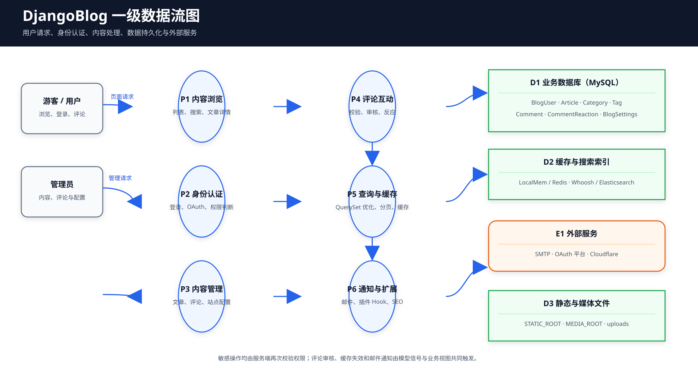
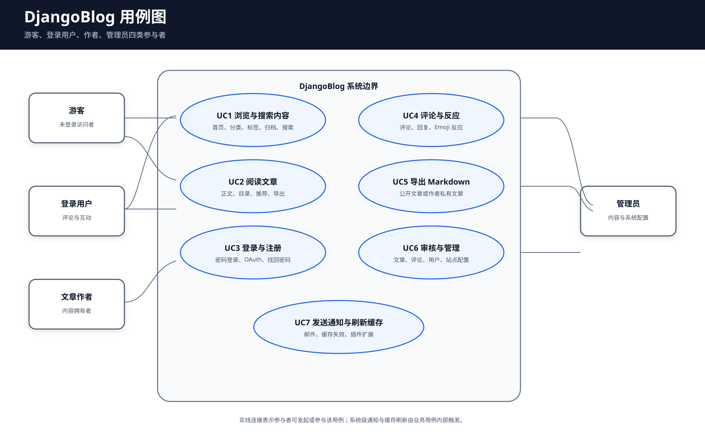
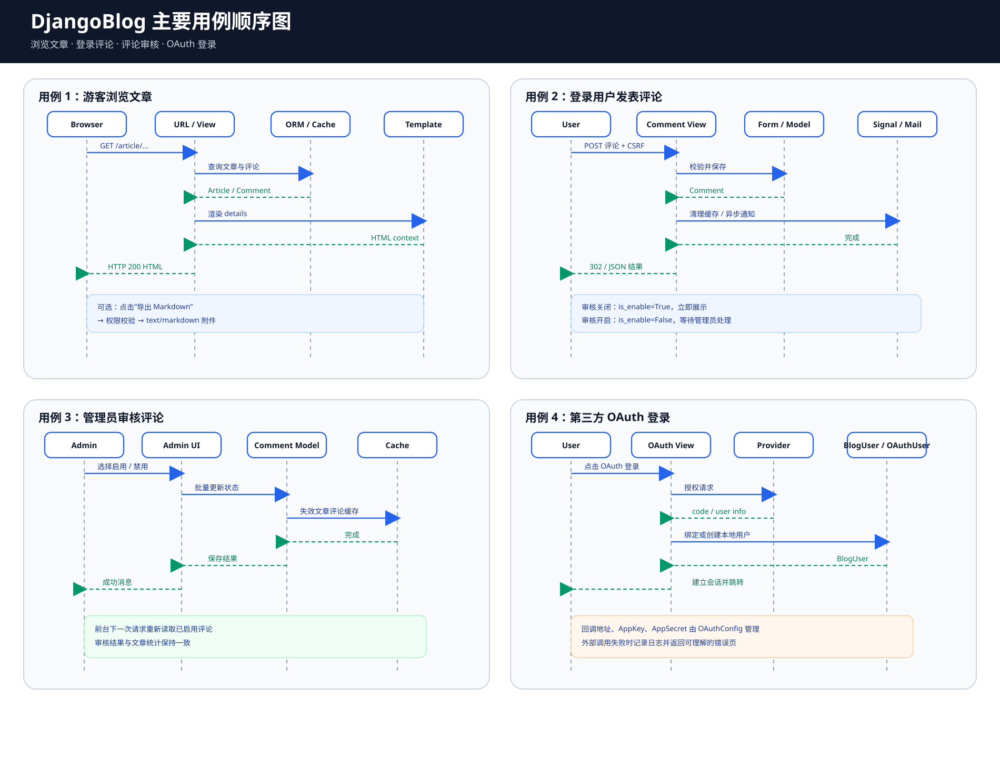

# DjangoBlog 系统架构与代码泛读报告

> 课程：软件工程
> 阶段：第 6 周
> 班级：软件工程 5 班
> 学号：2415304532
> 姓名：孙金龙
> 项目：DjangoBlog
> 文档版本：v1.0

## 1. 泛读目标

本报告在完成第 4—5 周界面建模和数据建模之后，从系统整体视角分析 DjangoBlog 的模块划分、请求处理链路、数据流、角色用例、缓存与插件机制。分析以当前仓库代码为准，重点阅读 `djangoblog`、`blog`、`accounts`、`comments`、`oauth`、`servermanager` 与 `plugins`。

## 2. 项目概览

DjangoBlog 是基于 Python 与 Django 的开源博客系统。项目采用服务端模板渲染，前端交互由少量 JavaScript 和 Vite 构建资源增强。系统既提供普通博客的浏览、分类、标签、搜索和评论，又包含 OAuth 登录、全文检索、插件扩展、邮件通知和后台运维功能。

### 2.1 技术栈

| 层次 | 技术 |
|---|---|
| Web 框架 | Django 5.2 |
| 数据库 | MySQL 8.0，开发测试可切换到 SQLite |
| ORM | Django ORM、模型信号、迁移 |
| 模板 | Django Template、自定义 Template Tags |
| 前端 | HTML、Tailwind/Bootstrap 样式、原生 JavaScript、Vite |
| 缓存 | LocalMemCache，可选 Redis |
| 搜索 | Whoosh，可选 Elasticsearch |
| 认证 | Django Session、用户名/邮箱登录、OAuth |
| 文档编辑 | django-mdeditor、Markdown 渲染 |
| 测试 | Django TestCase、Client、RequestFactory、Mock |

### 2.2 目录与职责

| 路径 | 职责 |
|---|---|
| `djangoblog/` | 项目配置、根路由、通用 View、缓存、搜索后端、插件加载、健康检查 |
| `blog/` | 文章、分类、标签、友情链接、侧边栏、站点设置及文章业务视图 |
| `accounts/` | 自定义用户、登录后端、注册与账户操作 |
| `comments/` | 评论、评论反应、评论表单、审核与通知 |
| `oauth/` | 第三方登录配置、账户绑定和回调处理 |
| `servermanager/` | 机器人命令、邮件发送日志和运维接口 |
| `plugins/` | 可插拔的文章推荐、阅读时间、SEO、版权、外部链接等扩展 |
| `templates/` | 全局布局、文章、账户、评论和搜索模板 |
| `frontend/` | Vite 管理的前端入口和交互组件 |
| `doc/` | 需求建模、架构、质量分析、维护与测试文档 |

## 3. 系统架构

### 3.1 表现层

表现层由 Django 模板、模板标签和少量前端组件构成。`share_layout/base.html` 提供统一页面骨架，文章页面、账户页面和搜索页面通过继承与包含组合布局。评论树、导航和 Emoji 反应等交互由 JavaScript 增强，后端仍负责权限和数据校验。

### 3.2 接口层

根路由 `djangoblog/urls.py` 首先注册健康检查和不参与国际化的入口，再通过 `i18n_patterns` 挂载各 App 路由。View 使用 `ListView`、`DetailView`、`FormView` 等类视图。`djangoblog/base_views.py` 将 CSRF、登录要求、敏感参数处理和缓存控制封装为可复用基类。

### 3.3 业务层

- `blog`：文章及关联对象是核心领域；
- `accounts`：自定义 `BlogUser` 扩展昵称、来源和时间字段；
- `comments`：通过 `parent_comment` 自关联实现树形评论；
- `oauth`：连接第三方身份与本地用户；
- `servermanager`：管理机器人命令和邮件日志；
- `plugins`：通过 Hook 在内容渲染、详情加载和缓存事件中扩展功能。

### 3.4 基础设施层

ORM 负责模型持久化，MySQL 保存业务数据，缓存保存列表、文章评论和站点配置，搜索后端保存文章索引，邮件与 OAuth 服务通过外部接口调用。项目通过 `cache_decorator`、QuerySet 的 `select_related`/`prefetch_related` 和组合索引减少重复查询。

### 3.5 关键架构决策

1. **单一 Django 工程、多 App 拆分**：业务按领域拆分，降低模型与视图耦合。
2. **约定式插件系统**：插件在启动时由 `load_plugins()` 注册 Hook，无需修改核心文章视图。
3. **服务端模板优先**：SEO、权限和表单校验更集中，减少前后端重复规则。
4. **抽象缓存常量**：`CacheTimeout` 和 `CacheKey` 统一管理缓存键，降低拼写错误。
5. **ORM 查询优化**：列表视图通过 Mixin 预取关联对象，模型为高频筛选设置组合索引。

## 4. 数据流分析

### 4.1 浏览与搜索

1. 浏览器发送文章列表、分类、标签、作者、归档或搜索请求；
2. 根路由匹配对应 View；
3. View 校验分页参数并构造 QuerySet；
4. 缓存命中时直接返回对象或列表，未命中时查询 MySQL；
5. 模板渲染文章卡片、侧栏和 SEO 元信息；
6. 浏览器接收 HTML 并加载静态资源。

搜索请求通过 Haystack 视图构建查询，Whoosh 或 Elasticsearch 返回命中结果和高亮片段。搜索索引与文章发布/修改之间存在异步特性，因此检索结果可能出现短暂延迟。

### 4.2 评论

1. 用户提交评论表单，Django 校验 CSRF、登录状态、文章评论开关和内容长度；
2. 根据 `comment_need_review` 决定 `is_enable`；
3. 保存评论后清理文章详情缓存和评论缓存；
4. 信号触发评论通知邮件；
5. 模板通过 `parent_comment` 递归渲染树形评论。

### 4.3 文章导出

第 9—10 周新增的 Markdown 导出链路如下：

1. 浏览器访问文章导出 URL；
2. View 查询文章并判断是否公开；
3. 非公开文章仅允许作者或管理员访问；
4. 服务将标题、元数据和正文组装为 Markdown；
5. 返回 `text/markdown` 附件，不修改原文章。

### 4.4 外部服务

邮件、OAuth、Cloudflare 和搜索服务均位于基础设施边界。外部服务异常时，应记录日志并向用户返回可理解的提示，不能使文章浏览等核心路径失效。

## 5. 用例分析

| 编号 | 用例 | 参与者 | 前置条件 | 主成功场景 | 异常与约束 |
|---|---|---|---|---|---|
| UC1 | 浏览与搜索内容 | 游客、登录用户 | 站点可访问 | 首页、分类、标签、归档或搜索返回结果 | 空结果展示空状态；搜索服务不可用时提示错误 |
| UC2 | 阅读文章 | 游客、登录用户 | 文章已发布，或用户有权查看 | 展示正文、目录、元数据、推荐和评论入口 | 草稿仅作者/管理员可访问 |
| UC3 | 登录与注册 | 游客 | 账户或 OAuth 配置有效 | 建立会话并返回原页面 | 密码错误、账户禁用或外部授权失败需反馈 |
| UC4 | 评论与反应 | 登录用户 | 文章允许评论 | 保存评论或切换 Emoji 反应 | 审核、重复反应唯一约束、CSRF 校验 |
| UC5 | 导出 Markdown | 游客、登录用户、作者 | 文章可访问 | 下载 UTF-8 Markdown 文件 | 非公开文章返回 404/403 |
| UC6 | 审核与管理 | 管理员 | 已登录且具备权限 | 更新文章、评论、用户和站点设置 | 单例配置约束、批量操作事务 |
| UC7 | 通知与缓存刷新 | 系统 | 业务写操作成功 | 更新缓存并发送邮件 | 外部邮件失败不回滚已保存评论 |

## 6. 主要用例顺序图

顺序图分别描述游客浏览文章、登录用户评论、管理员审核评论和 OAuth 登录。图中强调了三项实现约束：

- 浏览器与应用之间的请求必须经过 URL、表单和 CSRF 校验；
- 数据库写操作完成后才清理缓存和发送通知；
- 外部 OAuth/邮件调用失败时不能破坏本地核心数据。

## 7. 数据字典

数据字典见 [数据模型设计说明书](数据模型设计说明书.md) 第 3 节。该文档按实体列出字段类型、约束、默认值和说明，并在第 4 节给出关系基数与删除策略。本周架构分析沿用第 5 周模型，不重复维护两套字段定义。

## 8. 代码泛读结论

### 8.1 优点

- App 边界基本清晰，核心业务与账户、评论、OAuth 分离；
- 文章查询、评论树和列表页已使用 `select_related` 或 `prefetch_related`；
- 缓存键与超时时间集中定义，便于维护；
- 安全视图基类和 HTML 白名单降低常见 CSRF/XSS 风险；
- 项目已有较完整的业务测试和数据准备基类。

### 8.2 主要问题

| 问题 | 影响 | 后续处理 |
|---|---|---|
| 设置文件含开发默认数据库密码和密钥 | 不利于安全部署 | 第 9—10 周增加环境变量覆盖并写入维护报告 |
| 浏览量使用读后写，存在并发丢失更新 | 热门文章统计可能偏小 | 改为数据库原子更新 `F('views') + 1` |
| 健康检查只返回固定状态 | 无法判断数据库或缓存是否可用 | 增加数据库、缓存探测和测试 |
| `cache_decorator` 缺少函数元数据保留 | 调试和文档工具识别困难 | 使用 `functools.wraps` 并收窄异常捕获 |
| 部分中文文本存在历史编码问题 | 可读性下降 | 在维护阶段分批修复，禁止继续复制乱码 |

## 9. 阶段总结与下一阶段计划

第 6 周通过架构图、数据流图、用例图和顺序图建立了从需求到实现的中间模型。下一阶段按“质量分析—注释重构—功能优化—自动化测试—维护文档”的顺序推进。孙金龙选择 `oauth` App 作为个人精读模块，负责第三方登录安全、外部请求、账户绑定和系统级优化。
