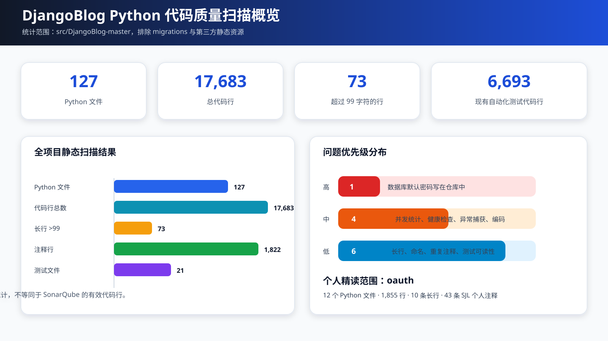

# DjangoBlog 第 7—8 周代码质量分析报告

> 课程：软件工程
> 阶段：第 7—8 周
> 班级：软件工程 5 班
> 学号：2415304532
> 姓名：孙金龙
> 负责 App：`oauth`
> 文档版本：v1.0

## 1. 分析目标与边界

本阶段对 DjangoBlog 项目进行静态阅读和质量改进，并选择 `oauth` 作为孙金龙的个人精读 App。该 App 负责第三方授权跳转、access token 获取、第三方用户信息解析、本地账户绑定、邮箱补充和登录会话建立。

团队内已由徐力艇选择 `blog`、朱梓诚选择 `djangoblog`、杜彬选择 `comments`，其他成员覆盖 `accounts`。选择 `oauth` 避免了模块重复，同时补充了登录安全和外部服务集成方面的精读范围。

### 1.1 分析范围

- 排除 `migrations` 自动迁移文件；
- 排除前端依赖、字体、压缩静态文件和第三方库；
- 统计 127 个 Python 文件、17,683 行文本；
- 个人精读 `oauth` 12 个 Python 文件、1,855 行文本；
- 对照 `README`、配置、路由、测试和调用方检查代码行为。

### 1.2 使用的方法与工具

1. IDEA/PyCharm Python、Django、PEP 8 检查规则；
2. PowerShell 文本扫描，统计数据行、长行、异常捕获和风险关键词；
3. `rg` 检索查询预加载、计数、缓存、密钥和 TODO；
4. Python 语法编译检查；
5. 阅读已有测试，按 App 统计测试覆盖材料；
6. 人工调用链复核：`urls.py → View → Form/Model → Signal/Plugin → MySQL/Cache`。

## 2. 质量概览



| 指标 | 全项目 | oauth |
|---|---:|---:|
| Python 文件 | 127 | 12 |
| 文本代码行 | 17,683 | 1,855 |
| 超过 99 字符的长行 | 73 | 10 |
| 注释行（扫描口径） | 1,822 | 91 |
| 现有测试文件 | 21 | 2 |
| 现有测试代码行 | 6,693 | 811 |

> 文本行统计只用于了解规模和定位长行，不等同于 SonarQube 的有效代码行、复杂度或重复率。

## 3. oauth 模块精读

### 3.1 模块职责

| 文件或子模块 | 职责 | 主要风险 |
|---|---|---|
| `models.py` | 第三方账户绑定与平台配置 | 令牌字段敏感、账户错绑 |
| `views.py` | 授权、回调、邮箱确认、会话 | 开放重定向、事务和签名校验 |
| `oauthmanager.py` | 五个平台授权和用户信息适配 | 外部请求超时、响应日志泄漏 |
| `forms.py` | 邮箱补充表单 | 隐藏字段被篡改 |
| `urls.py` | OAuth 路由和命名空间 | 回调地址不匹配 |
| `admin.py` | 绑定记录与平台配置管理 | 误改 openid/token |
| `templatetags/oauth_tags.py` | 渲染启用的平台入口 | 暴露敏感参数 |
| `apps.py` | Django App 注册 | 生命周期配置 |
| `tests.py` | 原有 OAuth 视图测试 | 外部平台需 Mock |
| `test_oauth_business_logic.py` | 业务逻辑和边界测试 | 维护测试数据成本 |

### 3.2 优点

- `BaseOauthManager` 为五个平台定义了统一的授权、token 和用户信息接口；
- `authorize()` 在事务中创建或更新本地用户及 OAuthUser，绑定操作具备原子性；
- `get_redirecturl()` 使用 Django 的 `url_has_allowed_host_and_scheme` 校验跳转地址；
- 邮箱确认链接包含 HMAC 签名，修改用户 id 不能直接完成绑定；
- 邮件补充流程将第三方登录与本地账户创建分开处理；
- 已有两个测试文件、811 行测试代码覆盖 OAuth 业务逻辑。

### 3.3 已发现的问题

| 编号 | 严重度 | 问题 | 位置 | 影响 | 处理状态 |
|---|---|---|---|---|---|
| Q1 | 高 | 授权流程未保存并校验 OAuth `state` | `views.py`、`oauthmanager.py` | 回调存在跨站伪造风险 | 列入后续安全优化 |
| Q2 | 中 | 外部 HTTP 请求未设置超时 | `oauthmanager.py` | 第三方平台卡顿会占满工作线程 | 已统一设置 10 秒超时 |
| Q3 | 中 | 日志输出完整第三方响应正文 | `oauthmanager.py` | 可能泄露 token、邮箱和昵称 | 已改为只记录 URL 和状态码 |
| Q4 | 中 | 平台响应解析使用较宽异常捕获 | `oauthmanager.py` | 难以区分网络、JSON 和字段错误 | 后续按阶段细化异常 |
| Q5 | 中 | 各平台构造函数重复读取配置 | `oauthmanager.py` | 新增平台时重复代码较多 | 后续抽取配置基类 |
| Q6 | 低 | `type` 参数遮蔽 Python 内置名 | `oauthmanager.py`、`views.py` | IDE 提示和可读性较弱 | 后续改名为 `provider_type` |
| Q7 | 低 | 10 条长行 | `oauth` | 横向阅读困难 | 新增代码按 99 字符控制 |
| Q8 | 低 | 各平台用户字段差异较多 | `oauthmanager.py` | 测试数据维护成本高 | 增加统一用户 DTO |
| Q9 | 低 | 部分测试重复准备用户和配置 | `oauth/tests.py` | 维护成本较高 | 抽取测试工厂函数 |
| Q10 | 低 | 第三方错误提示较简略 | `views.py` | 用户难以判断下一步 | 增加可理解的错误页 |

## 4. 个人代码注释

本次在 `oauth` 中补充模块级、函数/方法级和关键代码行注释，共 43 条个人注释，所有个人注释均使用 `#SJL:` 开头。示例：

```python
#SJL: OAuth 管理器模块，将微博、Google、GitHub、Facebook 和 QQ 的差异封装为统一接口。
```

```python
def do_get(self, url, params, headers=None):
    #SJL: 外部请求必须设置超时；日志只记录状态码，不输出可能含 token 的响应正文。
    rsp = requests.get(url=url, params=params, headers=headers, timeout=10)
    logger.debug('OAuth GET %s status=%s', url, rsp.status_code)
    return rsp.text
```

注释覆盖以下内容：

- 每个核心模块的职责；
- 授权跳转和开放重定向防护；
- token 获取、第三方用户信息解析和本地绑定事务；
- 邮箱确认签名和补充邮箱流程；
- 外部请求超时与敏感日志规避；
- OAuth 模型、表单、后台和模板标签的职责。

## 5. 代码改进

### 5.1 外部请求超时

原代码：

```python
rsp = requests.get(url=url, params=params, headers=headers)
```

改进：

```python
rsp = requests.get(url=url, params=params, headers=headers, timeout=10)
```

理由：OAuth 依赖外部平台，不能无限等待。10 秒超时可避免单个回调长期占用 Django 工作线程。

### 5.2 日志脱敏

原实现使用 `logger.info(rsp.text)` 输出完整响应。响应可能包含 access token、邮箱和第三方资料。改进后只记录请求 URL 与 HTTP 状态码，正文保留在内存中完成解析。

### 5.3 注释与安全边界

在授权跳转、事务绑定、签名校验、外部请求和模板标签处增加 `#SJL:` 注释，明确每个安全边界的意图。

## 6. 质量改进计划

### 6.1 第 9—10 周系统级处理

1. 数据库密码、Secret Key 和邮件配置统一从环境变量读取；
2. 浏览量采用数据库原子更新；
3. 健康检查探测数据库和缓存；
4. 新增文章 Markdown 导出功能，并覆盖权限测试；
5. 增加 SQLite 测试配置，降低学生本地验证门槛；
6. 形成维护报告、功能演示脚本和测试记录。

### 6.2 oauth 后续维护

1. 为 OAuth 授权流程增加 `state` 参数并校验回调；
2. 抽取统一配置基类和第三方用户 DTO；
3. 将 `type` 参数重命名为 `provider_type`；
4. 按网络、HTTP、JSON、字段四层细化异常；
5. 使用 Mock 补齐五个平台的成功和失败响应测试；
6. 将重复测试数据抽取到测试工厂；
7. 在 CI 中执行全部 OAuth 测试和危险日志扫描。

## 7. 结论

`oauth` 通过统一管理器适配多个第三方平台，授权码、用户信息和本地账户绑定链路完整，已有较充分的业务测试。主要风险集中在 OAuth `state` 校验、外部请求超时、响应日志脱敏和平台实现重复。本次已完成 43 条 `#SJL:` 注释，并修复外部请求超时与日志泄露问题；`state` 校验和异常分层纳入后续安全维护。
